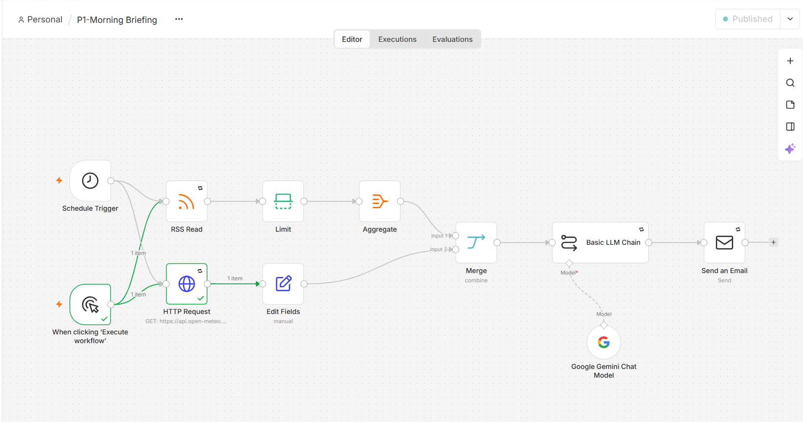

# Morning Briefing Automation (n8n + Gemini AI)

Every morning at 7:00 this workflow fetches the weather for Akure and the top 5 Africa headlines, uses Google Gemini to write a short, friendly briefing, and emails it to me.

## How it works
1. Schedule Trigger (daily, 9:00 Africa/Lagos)
2. HTTP Request → Open-Meteo weather API
3. RSS Read → BBC Africa headlines, limited to 5, aggregated into one list
4. Merge → Basic LLM Chain (Gemini) writes the briefing
5. Send Email (SMTP)

## Reliability
- Retry on fail (3 tries) on all external calls
- Linked error workflow emails an alert if a run fails

## Setup
Import the JSON into n8n, then add your own credentials: Google Gemini API key and an SMTP email account.

