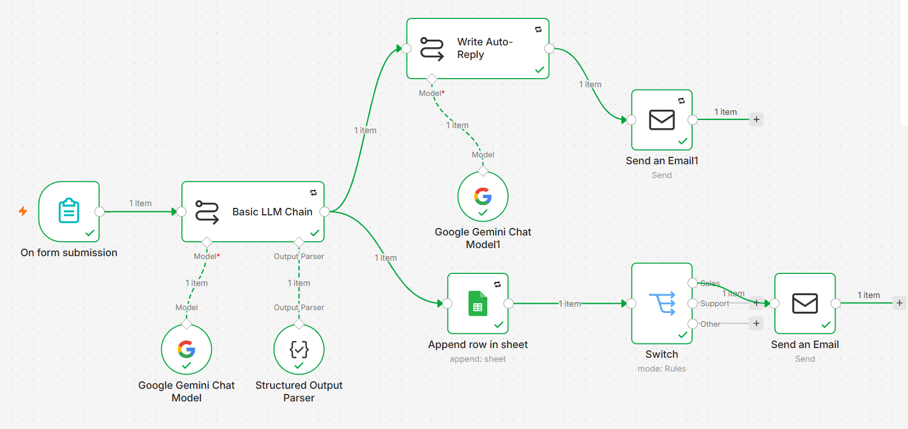

## Project 2: Smart Enquiry Form (n8n + Gemini + Google Sheets)

A contact form that uses AI to qualify every enquiry.

- Form submission → Gemini classifies it as **sales / support / other** using structured JSON output, with a one-line summary
- Every enquiry is logged to Google Sheets
- Sales leads trigger an instant alert email (Reply-To set to the customer)
- Customers receive an AI-written auto-reply with strict guardrails (no invented prices or promises)
- Retry on fail and a linked error-alert workflow

