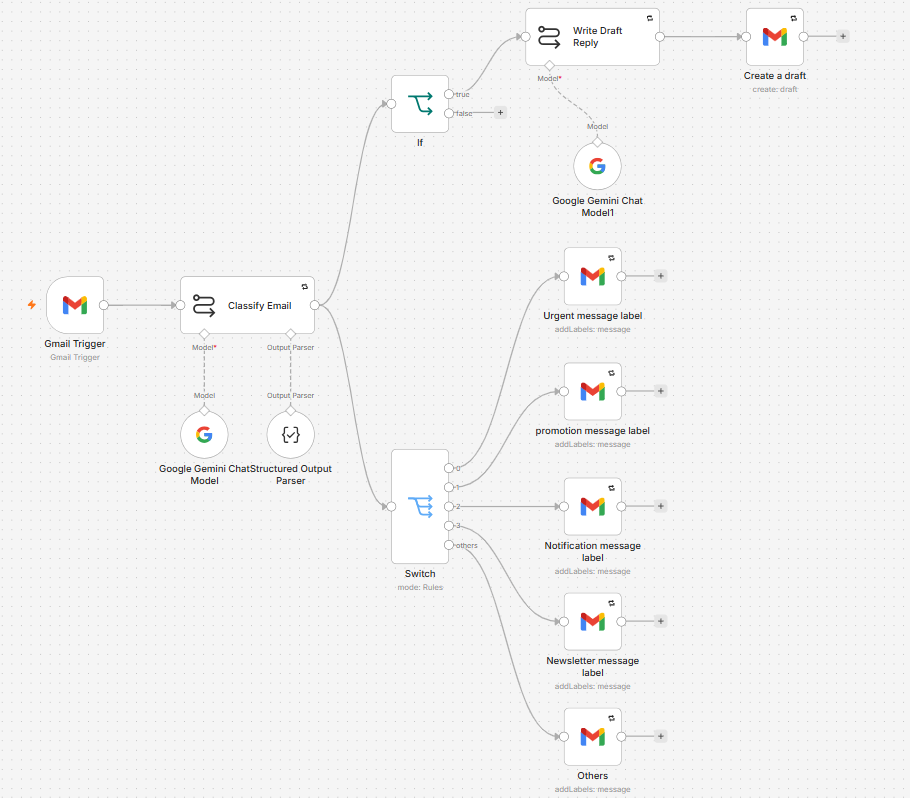

# AI Inbox Assistant (n8n + Gemini + Gmail)

An AI assistant that triages Gmail automatically and drafts replies, but never sends anything without human review.

## What it does
- Checks the inbox every 5 minutes for new unread emails
- Gemini classifies each email as **urgent / promotion / notification / newsletter / others** (structured JSON output) and decides whether it needs a reply
- Applies the matching Gmail label (AI/Urgent, AI/Promotion, …)
- For emails that need a response, writes a polite reply and saves it as a **draft in the original thread**
- Uses [placeholders] for anything it can't know (dates, decisions) instead of inventing facts

## Reliability
- Retry on fail for all AI and Gmail steps
- Linked error-alert workflow
- Ignores emails sent by the account owner

