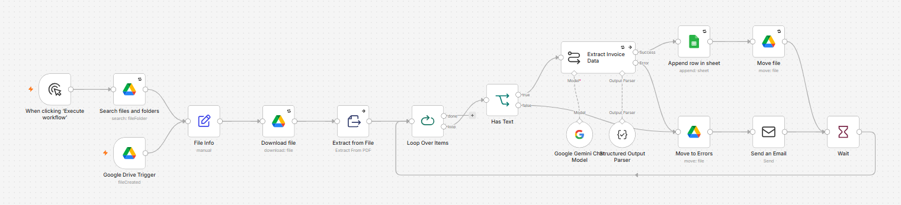

# AI Invoice & Receipt Extractor (n8n + Gemini + Google Drive + Sheets)

Drop a PDF invoice into a Google Drive folder — AI extracts the key data into a spreadsheet and files the document automatically.

## What it does
- Watches a Drive "Inbox" folder for new PDFs (plus a manual "process backlog" route for existing files)
- Extracts the text and uses Gemini with a strict JSON schema to pull out vendor, invoice number, date, currency, subtotal, tax, total and line items
- Amounts are returned as real numbers, so the sheet can total them
- Logs each invoice to Google Sheets with a link to the original file
- Moves processed files to "Processed"

## Reliability
- Files with no readable text (scans, blank pages) and AI failures go to an "Errors" folder for human review, never guessed
- One-at-a-time loop with a pause, which handles bulk uploads without hitting AI rate limits
- Retry on fail and a linked error-alert workflow

## Usage note
Upload or save new files into the Inbox folder. Moving an existing file into Inbox does not trigger processing; use the manual "backlog" run for existing files.

