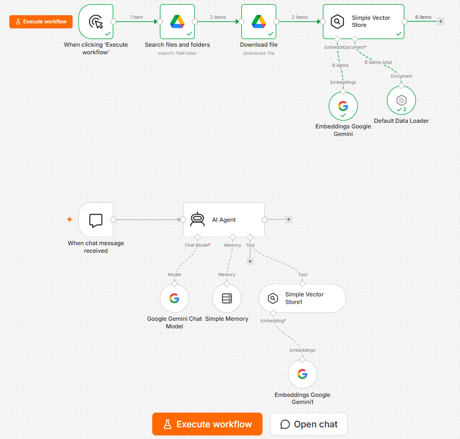

# AI Knowledge-Base Chatbot (RAG) — n8n + Gemini

A customer-service chatbot that answers questions **only** from a business's own documents.

## What it does
- Loads business documents (PDF FAQs, price lists, policies) from Google Drive
- Splits them into chunks and stores them as Gemini embeddings in a vector store
- An AI Agent searches the documents for every question and answers from what it finds
- Remembers the conversation, so follow-up questions work naturally
- Shareable hosted chat page (can also be embedded on a website)

## Guardrails (tested)
- Says "this isn't in my information" and gives the contact number instead of guessing
- Only states a "no" when the documents explicitly say so
- Asks for clarification when a question is ambiguous
- Declines off-topic questions and resists prompt-injection attempts
- Passed a 9-question test set: 9/9

## Tech
n8n AI Agent · Google Gemini (chat + embeddings) · vector store · Google Drive · conversation memory

