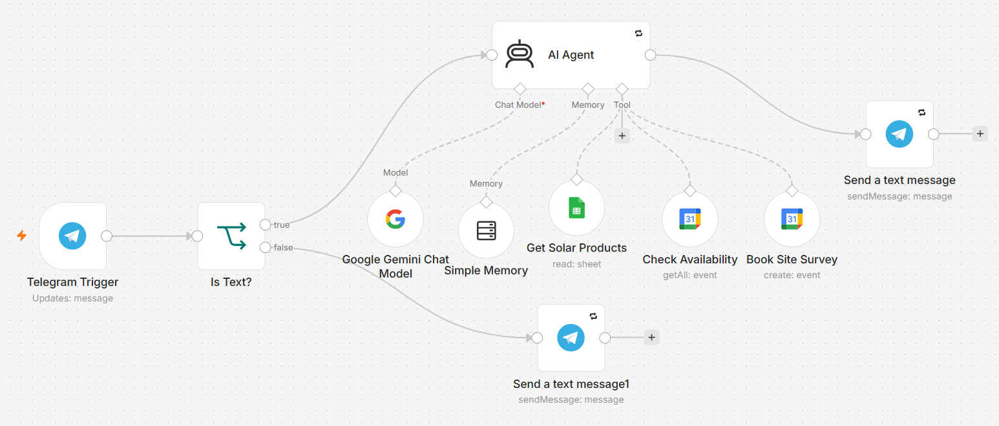

# Telegram AI Sales & Booking Assistant (n8n + Gemini)

A Telegram bot for a solar company that answers product questions from live data and books site surveys into Google Calendar.

## What it does
- Chats naturally and remembers each customer's conversation separately
- Looks up packages, prices and stock from a Google Sheet the business owner can edit (changes apply instantly)
- Recommends a package based on what the customer wants to power
- Books free site surveys: collects details, checks calendar availability, confirms with the customer, then creates the event
- Handles voice notes and photos gracefully

## Guardrails
- Never invents prices or availability, always checks the sheet
- Only books after explicit confirmation; respects working hours, service area and no past dates
- Retry on fail and a linked error-alert workflow

## Tech
n8n AI Agent with tools · Google Gemini · Telegram Bot API · Google Sheets · Google Calendar · per-user memory

