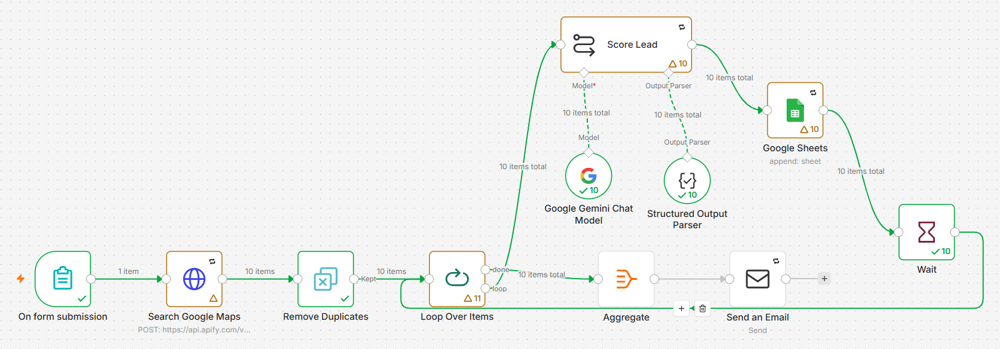

# AI Lead Generation & Outreach Pipeline (n8n + Gemini + Google Maps)

Turns "solar installers in a location" into a scored, ready-to-contact lead list in minutes.

## What it does
- Simple form: business type, city, number of leads
- Collects public business listings from Google Maps (via Apify)
- Skips businesses already processed in earlier runs, so no duplicate outreach
- Gemini scores each lead 1–10 with a transparent points system (reviews, reachability, online presence, booking-based business, data quality) and explains the score
- Writes a personalised, fact-based opening line for each lead
- Logs everything to a Google Sheet CRM with one-tap WhatsApp links (message pre-filled, sent by a human)
- Emails a summary with the top 3 leads when each run finishes

## Responsible by design
- Public business data only; no automated bulk messaging, so every message is human-reviewed
- Capped searches protect API costs; rate-limited processing stays within AI limits
- Retry on fail + error alerts

## Tech
n8n · Apify Google Maps scraper · Google Gemini (structured output) · Google Sheets · WhatsApp click-to-chat links · SMTP

