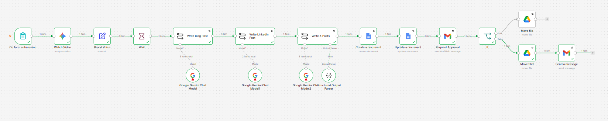

# AI Content Repurposing Machine (n8n + Gemini + Google Docs)

One video in → a blog post, a LinkedIn post and 3 X posts out, in a consistent brand voice, with human approval before anything is used.

## What it does
- Simple form: video link, brand name, audience, tone
- Gemini watches the video once and writes structured notes, with every number and fact labelled by its source (spoken, on screen, or description, with timestamps)
- A shared "brand voice" guides three writers: blog post (Markdown), LinkedIn post (plain text, platform-specific style) and 3 X posts (structured output, each under 280 characters)
- Saves everything to a Google Doc
- Emails an approval request and pauses until a person clicks Approve or Needs changes, then files the doc accordingly

## Guardrails
- Facts traceable to the source; no invented statistics, prices or currency conversions
- Output length adapts to the source to avoid filler
- Nothing is used without human approval
- Retry on fail and an error-alert workflow
- I spotted the longest AI step was the least reliable, so I added spacing, retries and a backup model

## Tech
n8n · Google Gemini (video understanding + structured output) · Google Docs · Google Drive · Gmail send-and-wait approval

